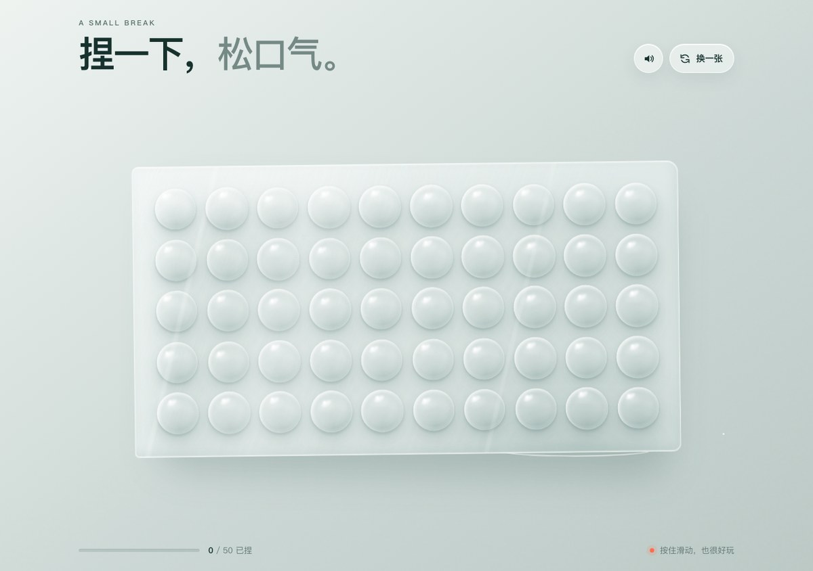

# 捏一下 · 电子泡泡纸

一张可以反复捏、带真实音效的电子泡泡纸。纯静态单页，无构建、无依赖。

## 🎮 在线试玩

<https://borissun0424-boop.github.io/bubble-wrap-pop/>




## 玩法

- 点击或按住滑动捏泡泡，带清脆音效与轻微震动反馈
- 右上角「换一张」重新铺一张泡泡纸，「声音」按钮开关音效
- 桌面 / 手机自适应

## 本地运行

```bash
python3 -m http.server 8080
```

然后打开 <http://127.0.0.1:8080/>

## 部署

纯静态站点，把仓库根目录当作站点根目录即可。

- GitHub Pages：Settings → Pages → Source 选 `main` 分支 `/ (root)`
- 也可以直接在 Vercel / Netlify / Cloudflare Pages 导入这个仓库

## 文件结构

```
index.html   页面结构
style.css    泡泡纸材质与布局
script.js    捏泡、音效、换一张
```

## 说明

个人项目，保留所有权利。
